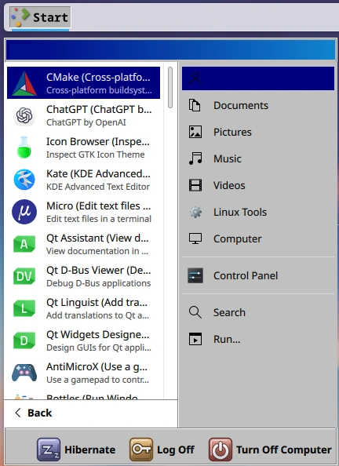
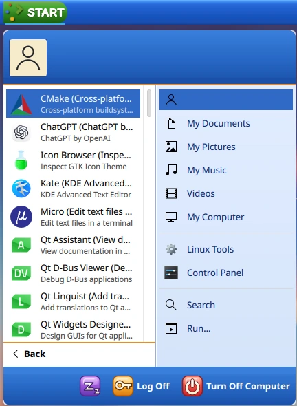
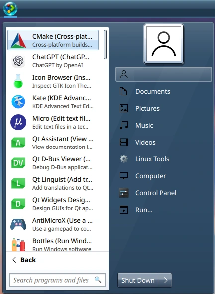
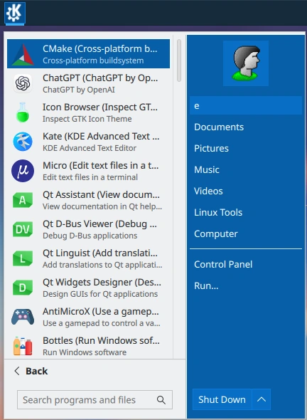
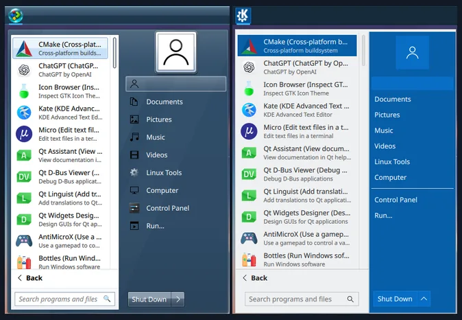

# 

A Start menu for KDE Plasma 6. Four styles, one menu for your apps, favorites, search, and session controls.

## Menu styles

| Classic | Exposed |
| --- | --- |
| [](docs/media/classic.webp) | [](docs/media/exposed.webp) |

| Aero (Arrow) | Metropolis |
| --- | --- |
| [](docs/media/aero.webp) | [](docs/media/metropolis.webp) |

## Color presets

The Aero frame and Metropolis sidebar each have their own color presets.



## Install

Download the `.plasmoid` from the release. Right-click the panel, enter **Edit Mode**, then open **Add Widgets → Get New Widgets → Install Widget From Local File**. Select the package, then drag **Start Bay** onto your panel.

You can also install from a source checkout.

```sh
kpackagetool6 --type Plasma/Applet --install .
```

Use `--upgrade` to update an existing installation. Start Bay uses KDE Plasma 6’s application catalog and its enabled search providers. Captured on Plasma 6.8.3.

## Use

- Right-click the panel button and choose **Configure Start Bay** for styles, colors, and grouping.
- Right-click an app for its menu. Drag entries to reorder them, and drag an outer corner to resize the menu.

<details>
<summary>Look closer</summary>


Choose **Clank Eye** from the icon picker for the little KDE × Open Clank button. [See it on the panel](docs/media/clank-eye.webp).

</details>

<details>
<summary>Package from source</summary>

The widget is QML. This command packages the applet with its artwork and font.

```sh
zip -r start-bay.plasmoid metadata.json metadata.desktop contents LICENSE LICENSES NOTICE.md
```

</details>

[GPL-2.0-or-later](LICENSE) · [Upstream code, artwork, and font credits](NOTICE.md)
